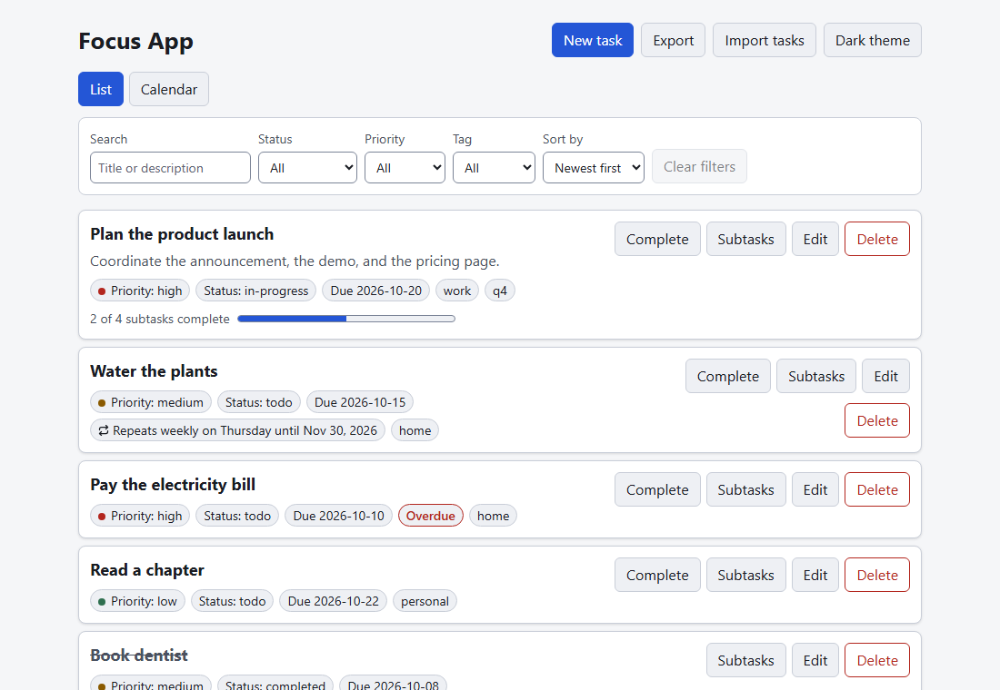
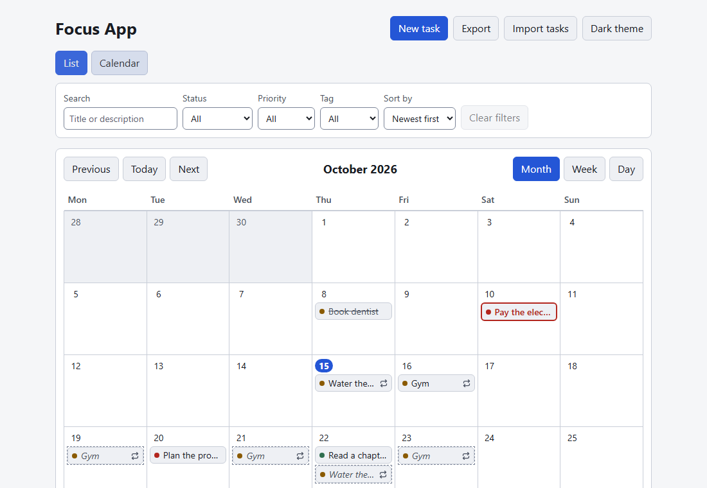
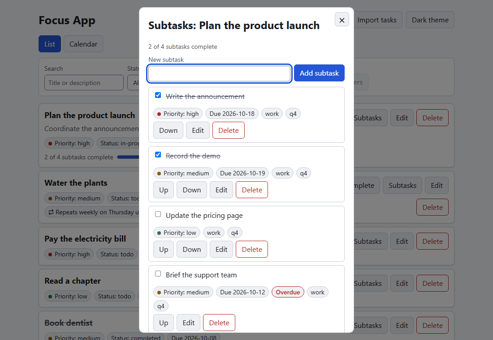
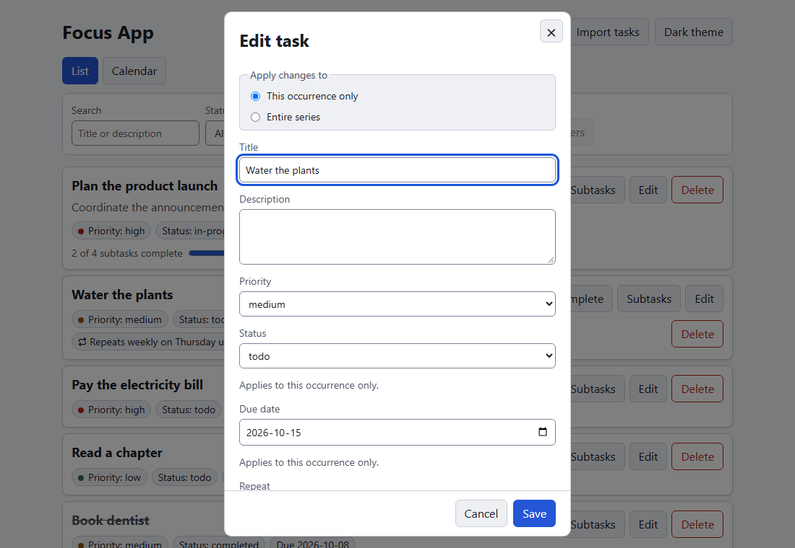
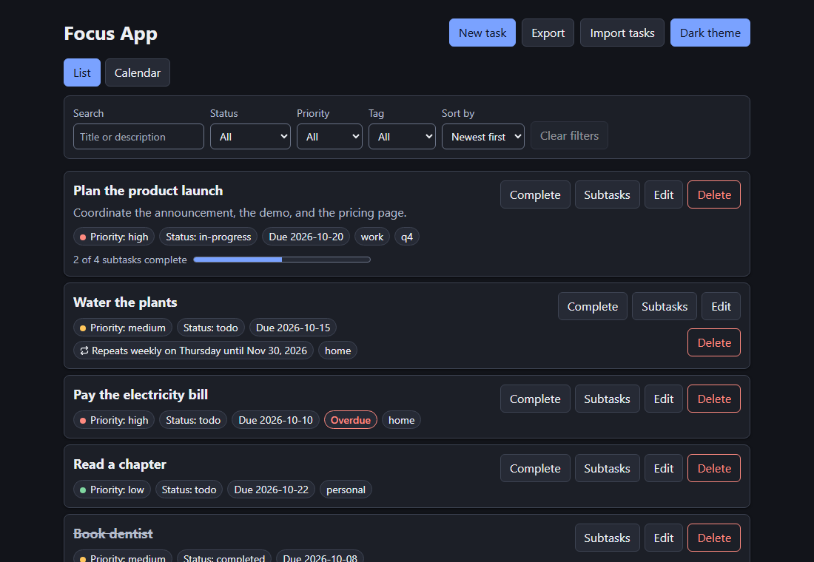

# Focus App

A personal task manager that runs entirely in your browser. There is no backend and no account:
your tasks are stored on your own device.

**Live demo: https://shayekh.github.io/spec-focus-app/**



## What it does

- **Tasks**: create, edit, mark complete, and delete tasks (delete asks for confirmation).
- **Task fields**: title (required), description, priority (`low`, `medium`, `high`), status
  (`todo`, `in-progress`, `completed`), an optional due date, and tags.
- **Find things**: filter by status, priority, and tag (filters combine), search title and
  description, and sort by newest, due date, or priority.
- **Overdue**: incomplete tasks past their due date are flagged.
- **Task form**: adding and editing happen in one modal dialog. Closing it with unsaved changes asks
  first, the page underneath is unavailable while it is open, and focus returns to where you were.
- **Calendar**: switch from the list to a month, week, or day calendar showing each task on its due
  date, with today marked. Click a task to open it, drag it to another date to reschedule it, or do
  the same from the keyboard with the task's Move button and the arrow keys. The list's filters
  apply to the calendar too.
- **Repeating tasks**: make a task repeat daily, weekly, monthly, or on chosen weekdays, with an
  optional end date. Completing it creates the next one from its schedule. Change just one
  occurrence or the whole series, or stop repeating. Upcoming dates show on the calendar as dashed
  previews.
- **Subtasks**: break a task into up to 50 steps from its Subtasks button. Add, edit, tick off,
  reorder, and delete them; each can have its own priority and due date and shows the task's tags.
  The task shows progress, offers (but never forces) to complete itself when the last step is done,
  and completing it completes its steps.
- **Saved locally**: tasks and your theme choice survive closing and reopening the browser.
- **Backup**: export all tasks to a JSON file and import them back. Importing replaces the current
  tasks after you confirm.
- **Themes**: light and dark, following your system setting until you choose one.
- **Several tabs**: a change in one tab shows up in the others without reloading.
- **Keyboard and accessibility**: every action works from the keyboard, dialogs trap focus and
  return it when closed, and text contrast meets WCAG AA in both themes.

## Screenshots

**Calendar.** Tasks sit on their due dates, today is marked, and upcoming occurrences of repeating
tasks show as dashed previews with a repeat symbol.



**Subtasks.** Each task opens a dialog of steps with their own priority and due date, shown with the
task's tags. Steps can be ticked off, edited, reordered, and deleted.



**Task form.** Adding and editing share one dialog. For a repeating task it asks whether a change
applies to this occurrence or the entire series, and offers Stop repeating.



**Dark theme.** Light and dark both meet WCAG AA contrast.



Because data lives in the browser, clearing site data removes your tasks. Use **Export** to keep a
copy.

## Setup

Requirements: [Node.js](https://nodejs.org/) 22.12 or newer and npm.

```bash
npm install
npx playwright install chromium   # only needed to run the end-to-end tests
npm run dev
```

Then open <http://localhost:5173>.

## npm scripts

| Script | What it does |
|--------|--------------|
| `npm run dev` | Start the Vite dev server on port 5173 |
| `npm run build` | Type-check, then build the app into `dist/` |
| `npm run preview` | Serve the production build locally |
| `npm run typecheck` | Run `tsc --noEmit` (strict mode must pass with no errors) |
| `npm test` | Run unit and component tests with Vitest |
| `npm run test:e2e` | Run end-to-end tests with Playwright (starts the dev server if needed) |

## Tech stack

TypeScript (strict), React 18, Vite, Vitest with Testing Library, and Playwright. Styling is plain
CSS with theme variables. There are no other runtime dependencies.

## Project structure

```text
src/
├── domain/        Pure business logic, no React or browser APIs
│   ├── task.ts      Task types, validation, create/update/complete
│   ├── taskDraft.ts Task form values, unsaved-changes rule, form validation
│   ├── subtasks.ts  Subtask rules: add, edit, tick, move, delete, progress, overdue, repair
│   ├── priority.ts  Priority values shared by tasks and subtasks
│   ├── calendar.ts  Month/week/day grids, grouping tasks by date, rescheduling
│   ├── dates.ts     Whole-day date arithmetic shared by the calendar and repeats
│   ├── recurrence.ts Repeat rules: next date, upcoming dates, wording, validation
│   ├── series.ts    Completing, editing, stopping and deleting repeating tasks; previews
│   ├── query.ts     Filter, search, sort, tag list, stale-tag reset
│   ├── overdue.ts   Overdue rule and local date helper
│   └── transfer.ts  Export file format and import validation
├── storage/       Browser persistence
│   ├── taskStore.ts    Versioned task document in localStorage
│   ├── preferences.ts  Theme choice
│   └── crossTab.ts     Reload when another tab changes the data
├── state/
│   └── useTasks.ts  Reducer and hook tying the domain to storage
├── ui/            React components (App, TaskForm, TaskList, FilterBar, TransferMenu, ...)
│                  plus Modal.tsx (shared dialog shell), modalStack.ts (page isolation), and the
│                  calendar (Calendar.tsx, CalendarDay.tsx, CalendarEntry.tsx, CalendarPreview.tsx,
│                  ViewSwitch.tsx), the repeat controls (RepeatFields.tsx, RepeatIcon.tsx), and
│                  the subtasks dialog (SubtasksDialog.tsx, SubtaskRow.tsx)
├── styles/        tokens.css (light and dark variables), typography.css, app.css, calendar.css
└── main.tsx       App entry point

tests/
├── unit/          Domain, storage, state, performance, and contrast tests
├── component/     React component tests
└── e2e/           Playwright browser tests

specs/<NNN>-<feature>/       One folder per feature: specification, plan, design docs, tasks
```

Business rules live only in `src/domain/`, which must not import from the UI, state, or storage
layers, so they can be tested on their own.

## Specification

Each feature has its own folder under `specs/` with a specification, plan, design documents, and a
task list. Later versions extend the earlier ones.

| Version | Feature | Specification |
|---------|---------|---------------|
| v1 | Task management: create, edit, complete, delete, filter, search, sort, themes, backup | [`001-task-management`](specs/001-task-management/spec.md) |
| v2 | Task form modal: close button, unsaved-changes confirmation, isolated and keyboard-accessible dialog | [`002-task-form-modal`](specs/002-task-form-modal/spec.md) |
| v3 | Calendar view: month, week, and day views, open a task, reschedule by drag or keyboard | [`003-calendar-view`](specs/003-calendar-view/spec.md) |
| v4 | Recurring tasks: daily, weekly, monthly, or chosen weekdays; end date; edit one or all; stop; calendar previews | [`004-recurring-tasks`](specs/004-recurring-tasks/spec.md) |
| v5 | Subtasks: ordered steps with their own priority and due date, progress, complete-the-parent prompt | [`005-subtasks`](specs/005-subtasks/spec.md) |

Each folder also holds `plan.md` (implementation plan), `research.md` (decisions), `data-model.md`,
`contracts/` (UI behavior), `quickstart.md` (manual validation scenarios), and `tasks.md` (the task
list).

Project principles (independently testable features, explicit tested business logic, simplicity,
strict TypeScript, accessible UI, local-first) are in
[`.specify/memory/constitution.md`](.specify/memory/constitution.md).
